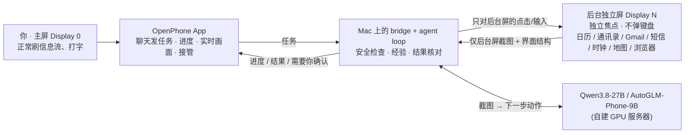

# OpenPhone Agent

**你照常用手机，Agent 在同一台手机的「后台独立屏幕」上替你操作真实 App。** 你的前台画面、焦点和键盘始终是你自己的；需要你本人决定的事（付款、登录、协议、权限、发送），Agent 停下来交给你。

▶️ **[演示视频（YouTube，2 分钟，中文字幕）](https://www.youtube.com/watch?v=2Jtdmli2-1E)**：左边是 Agent 的后台屏，右边是用户的主屏。任务一用 12306 查火车票（2 倍速），任务二用一句口语写 Gmail 邮件，写好后交给用户接管、由用户自己发送（1.25 倍速）。看不了 YouTube 时可以[下载 MP4](https://github.com/JaveyBae/openphone-agent/releases/download/v0.1-demo/openphone-demo.mp4)。

[](https://www.youtube.com/watch?v=2Jtdmli2-1E)

- 每一步都由视觉模型看屏幕决定（默认 Qwen3.8-27B，也支持 AutoGLM-Phone-9B），不是回放脚本。
- 做成功过的任务会从**模型自己的真实运行轨迹**里学出经验，下次同类任务直接复用导航步骤，越用越快（实测快 32%，模型调用从 18 次降到 7 次）。
- 模型说“办好了”之后，系统会**到 App 里独立核对**；核对不过会让模型自我纠正一次，仍不过就如实交给你，绝不把模型的说法当结果。



## 成功率（正式测试，2026-10-19）

4 个固定任务，每个配置各跑 5 次。用独立于 Agent 的方式核对结果：读系统闹钟列表、读通讯录界面、查日历数据库里的标题/日期/起止时间，12306 车次与页面比对。每次运行前后都清理测试数据。

| 任务 | 9B 纯 Agent | 9B 经验模式 | 27B 纯 Agent（平均用时） | **27B 经验模式**（平均用时） |
|---|---|---|---|---|
| 定闹钟 | 5/5 | 5/5 | 5/5（38 s） | **5/5（28 s）** |
| 新建联系人（5 个字段） | 1/5 | 5/5 | 5/5（92 s） | **5/5（55 s）** |
| 建日程（日期 + 起止时间） | 2/5 | — | 4/5（86 s） | **5/5（47 s）** |
| 12306 查最早一班高铁 | 3/5 | — | 5/5（43 s） | **5/5（28 s）** |
| **合计** | 11/20 | 10/10 | 19/20 | **20/20** |

- 27B 经验模式是 10-19 修复之后跑的：比纯 Agent 快约 40%，日程任务从 4/5 提到 5/5。它测的是“同类任务重复做”，正是经验模式要解决的场景；换一种说法、多一个字段（例如带地点的日程）时，仍然要靠模型多走几步。火车票这一组查的是 10 月 22 日，因为测试时北京已过零点，原来查的 10 月 20 日已经是当天。
- 离线逐步评测（58 个真实截图步骤）：27B 做对 45 步（77.6%），9B 做对 36 步（62.1%）。所以默认模型换成了 27B。
- 9B 用经验模式后，联系人任务从 1/5 提到 5/5：经验能弥补小模型。
- 在 App 上实际验证过的口语任务：
  - “用12306查10月22日上海到北京最早出发的一班高铁”，72 s 查到 G532 06:31，并附各席位票价；
  - “帮我写封邮件给 …，就说文档我看完了，没什么问题，可以往下推了”，9 步写好草稿：主题由模型自拟，写完停下交给用户。
- 带地点的日程（“……需求评审会，地点三楼大会议室”）27B 能做成，但需要 4–5 分钟，见“局限”。

## 早期实测（9B，Android 15 ARM64 模拟器，2026-10-16 ~ 10-18）

| 任务 | 模式 | 结果 | 用时 / 步数 | 说明 |
|---|---|---|---|---|
| 新建联系人（名、姓、电话、邮箱、公司 5 项） | 纯 Agent | ✅ 核对通过 5/5 | 123 s / 18 步 | 长表单，含滚动找字段；自动学出经验 |
| 同类任务、换一组数据 | 经验模式 | ✅ 核对通过 6/6 | **83.6 s / 17 步，只调模型 7 次** | 10 步导航按经验直接执行 |
| 定闹钟“早上 7:40 叫我起床” | 纯 Agent | ✅ 系统闹钟列表核对 | 21.1 s / 6 步 | 打开时钟 → + → 表盘选时间 → OK |
| 定闹钟“早上 8:30” | 经验模式 | ✅ | 25.6 s / 6 步 | 2 步按经验，4 步由模型 |
| Google 地图：Zürich HB → Uetliberg 最快公交方案 | 纯 Agent | ✅ 找到最快方案（1 h 10 min，N3 换 N2） | ~100 s / 17–20 步 | 比较多个方案；“收藏到想去”这一步 9B 尚未做成 |
| Google 航班：10/25 苏黎世 → 巴黎单程 | 纯 Agent | ⚠️ 搜索成功，只汇报了最低价 | 108.7 s / 19 步 | 自己改单程、选日期、搜索 |
| 先查日历再写晚到短信（跨两个 App） | 纯 Agent | ❌ 模型跳过查日历 | — | 9B 不擅长多应用串联，见“局限” |

模型撒谎被抓住的真实例子：一次新建联系人，模型只填了名字和公司就保存，却回复“电话、邮箱都已保存”。完成核对在通讯录里找不到邮箱和电话，没有当作完成；加入自我纠正后，同一任务完整做成并核对通过。

## 为什么这样做（技术选型）

| 方案 | 能否“同时用、不打扰” | 结果是否落在用户自己的 App/账号 | 结论 |
|---|---|---|---|
| **后台独立显示屏 + 独立焦点（本项目）** | ✅ 后台屏有自己的焦点，主屏键盘/焦点不受影响 | ✅ 同一台手机上的真实 App 和账号 | **采用** |
| 在主屏上操作（多数手机 Agent） | ❌ 会抢屏、抢焦点 | ✅ | 不符合题意 |
| MediaProjection 录屏 + 无障碍点击 | ❌ 无障碍手势作用在主屏 | ✅ | 早期试过：只能看不能操作后台 |
| 第二台手机 / 云手机 | ✅ | ❌ 不是用户自己的设备和登录态 | 绕开了题目的难点 |
| Root / 修改 ROM | ✅ | ✅ | 普通用户无法落地 |

关键点：Android 15 允许 shell 身份（UID 2000）创建带 `OWN_FOCUS`、`STEAL_TOP_FOCUS_DISABLED`、`TRUSTED`、`DESTROY_CONTENT_ON_REMOVAL` 的虚拟显示屏。它有独立的输入焦点，App 在上面运行时不会抢走主屏焦点；移除时里面的任务被销毁，而不是掉回主屏。细节和逐项验证见 [docs/workspace-isolation.md](docs/workspace-isolation.md)。

### 怎么做到“不打扰”
- **只操作后台屏**：所有点击/滑动都带 `-d <后台屏>`。每一步前后都核对后台屏的身份和隔离标志，并确认全局焦点仍在主屏；不满足立即停止（fail closed），从不“自动把焦点切回来”掩盖问题。主屏暂时没有焦点窗口不算违规（例如你打开最近任务、下拉通知栏），因为这是你在正常用手机。
- **不碰你的键盘**：后台屏不会弹输入法。文字通过 `UiAutomation` 的 `ACTION_SET_TEXT` 写入后台屏中已聚焦的输入框（只取后台屏的窗口根节点），短信/Gmail 收件人栏用定向到后台屏的按键事件；不切换输入法、不用剪贴板。
- **只看后台屏**：模型只收到后台屏截图；主屏画面从不发给模型。
- **同一个 App 的边界**：Android 一个 App 通常只有一个任务。你和 Agent 同时打开同一个 App 时，系统会把任务移到你这边。此时 Agent 停止并提示，不关闭、不搬走你的窗口；提示里提供「关闭主屏的 X 并继续」按钮，只有你点了才执行。

## Agent 是怎么工作的

每一步：截后台屏 → 读界面结构 → 决定下一步（模型或经验）→ 安全检查 → 执行 → 记录。

- **模型**：默认 Qwen3.8-27B（`--provider qwen`，JSON 动作），也支持 AutoGLM-Phone-9B 多语言版（`--provider autoglm`）。两个模型都部署在自有 GPU 服务器上，经 SSH 隧道以 OpenAI 兼容接口调用，部署说明见 [docs/autoglm-n30285.md](docs/autoglm-n30285.md)。也可以换成任何能输出动作的视觉模型（`--provider openai`）。
- **教师数据**：用 Claude 当教师模型，给真实轨迹逐步标注正确动作，生成 27B 的 SFT 数据（`scripts/teacher_dataset.py`）。Claude 在后台屏亲自演示做成的日程任务，也会作为经验被学进来。
- **执行反馈（让小模型少走弯路）**：系统把这些事实反馈给模型，而不是让它猜——
  - 输入框已确认获得焦点，并说出是哪个输入框，明确“不要再点，下一步直接输入”。后台屏没有键盘和光标，模型容易反复点输入框；
  - 从界面读出的事实（`scripts/screen_notes.py`）：例如日历的时间弹窗设的是开始时间还是结束时间、当前显示几点，表单里现在填了什么，地点页要按回车才能保留原文；
  - 今天的日期（12306 用北京时间，“明天”要按页面理解）；
  - 上一步操作没让屏幕发生任何变化（例如已滑到底）；
  - 在两三个位置之间打转（周期 2/3 的循环检测）；两个动作来回交替 3 轮就提前停下，交给用户；
  - 想打开的 App 没装（让它改用浏览器等其他办法）；
  - 说“完成”但核对没通过（列出缺失项，让它继续）。
- **对模型输出的容错**：一次输出多个动作时只执行第一个（其余在下一张截图上重新决定）；“操作 + 宣布完成”只执行操作；空输出、引号坏掉，或输出了不可执行的格式（例如没有元素列表时却按元素编号点击）时，告诉模型错在哪、让它重答一次；输入的文字里带换行时不执行，并提示它改用回车键。

## 经验模式：从模型的真实轨迹中学习（`scripts/experience.py`）

App 底部可切换 **⚡ 经验模式**（默认）/ **🧠 纯 Agent**。

1. **记录**：每一步执行前读后台屏的界面结构，记下屏幕“指纹”（控件 id 和短标签），以及模型点的是**哪个控件**（按身份，不按坐标）。原始记录保存在每次运行目录的 `recording.json`。
2. **学习**（只有核对通过的运行才学）：删掉绕路（同一屏幕上重复同一动作，中间那段是弯路），再把每步分类：
   - **结构步骤**：打开 App、点“+”、点某个输入框、滚动——同类任务都一样；
   - **内容步骤**：输入文字，或点的控件带着本次请求的值（日期、时间、城市、上午/下午、单程/往返）；
   - **提交步骤**：保存、OK、发送、搜索。
3. **复用**：经验模式下每一步先比对实时屏幕；只有“结构步骤 + 屏幕指纹一致 + 该控件在当前屏幕上找得到”才直接执行，否则交给模型。内容和提交永远由模型决定，弹窗和陌生页面也由模型处理；直接执行的步骤同样要过全部安全检查。

所以它不是手写脚本：步骤来自模型自己做成功的运行，每一步都以实时屏幕为前提，对不上就回到模型。旧的手写技能保留为 `--mode legacy`，仅用于对比。

## 结果核对与自我纠正（`scripts/completion_check.py`）

模型说完成后：从请求中取出明确的值（邮箱、电话、英文名、「」引号内容），在 App 最终界面结构里逐一查找。闹钟请求还要在系统闹钟列表（`dumpsys alarm`）或时钟 App 的开关上查到对应时间；日程请求要到系统日历数据库里查到标题、日期、起止时间（按设备时区），请求里提到的地点也要对上。缺了就把缺失项反馈给模型继续做一次；仍缺就标为“需要你核对”，并列出缺什么。核对通过才算完成、才学经验，回复里写明核对到了哪些值。

## 安全边界

- 短信、邮件**只写草稿**：短信点击只允许白名单控件（拒绝 Send 和未知控件），Gmail 拒绝发送/删除/归档和侧滑。
- **整页检查**：美团、Agent 浏览器（Google 航班）等页面上出现下单/付款/协议/验证码登录/Cookie 同意字样时，任何点击、滑动、输入都不执行。
- **系统权限弹窗**：允许和拒绝都不替你点。
- **随时接管**：App 里每个暂停的任务都有「接管到主屏」，把后台窗口交给你继续操作。
- 不安装开机自启服务、不上传主屏截图；运行记录（`runs/`）与经验（`experiences/`）只存本地且已 gitignore。

## 权限与在普通用户手机上落地

- **需要**：Android 15+（独立焦点虚拟屏），一次 ADB 授权（USB 或「无线调试」配对）。**不需要 Root、不改系统、不需要系统签名。**
- 当前原型的控制端跑在 Mac 上（bridge + agent loop），手机端是普通 App 加一个以 shell 身份运行的小服务（`app_process` 启动的 DEX，只用 shell 已有权限）。
- 落地到普通手机：参考 Shizuku 的做法——用户在手机上开一次「无线调试」并配对，App 在本机拉起 shell 身份的常驻服务（创建后台屏、截图、输入），之后不需要电脑；模型可以走云端 API 或端侧小模型。
- 已知限制：个别 ROM 不允许 shell 创建这类显示屏时会安全失败；部分国内 App 对模拟器风控严格（京东/淘宝/美团会弹验证），真机上会好很多。

## 运行

```bash
export ANDROID_HOME="$HOME/Library/Android/sdk"
export JAVA_HOME="/Applications/Android Studio.app/Contents/jbr/Contents/Home"
./gradlew assembleDebug && adb install -r app/build/outputs/apk/debug/app-debug.apk
python3 scripts/workspace_runtime.py start          # 创建后台独立屏
python3 scripts/chat_bridge.py --provider qwen \
  --base-url http://127.0.0.1:18086/v1 --model qwen3.8-27b --max-steps 40
# 或者用 9B：--provider autoglm --base-url http://127.0.0.1:18085/v1 --model autoglm-phone-9b-multilingual
python3 scripts/display_viewer.py --both            # 可选：Mac 上并排看主屏和后台屏
```

在手机上打开 **OpenPhone**，直接用中文发任务。离线调试可用 `--provider mock`。单元测试：`python3 -m unittest discover -s tests`（当前 239 项）。录制演示见 [docs/DEMO.md](docs/DEMO.md)，答辩提纲见 [docs/DEFENSE.md](docs/DEFENSE.md)。

## 局限（如实）

- **速度**：27B 每步 2–10 秒（取决于到 GPU 服务器的网络），复杂任务要几分钟。例如带地点的日程需要 4–5 分钟，演示视频做了加速。网络断开时任务会如实停下，提示“连不上模型服务器”。
- **9B 模型的定位精度**：表盘上相邻数字会点错，偶尔反复点同一处；成功率依赖上面的反馈机制，仍不是 100%。
- **跨 App 串联**（先查 A 再做 B）：9B 会跳过前一步。下一步计划“先拆任务再逐步执行”的规划层（拆分可用同一模型或更强的规划模型）。
- **Google 地图收藏**、国内电商下单等更深的流程尚未稳定做成。
- 控制端目前在电脑上；手机本地化（Shizuku 式服务）尚未实现。

## 目录

```
app/                     OpenPhone App（聊天、进度、实时画面、接管、模式切换、历史对话）
tools/workspace/         shell 身份运行的后台屏服务、文本输入与控件检查（Java → DEX）
scripts/agent_loop.py    命令行入口：解析参数，组装设备、模型和运行日志
scripts/agent_session.py 一次任务：观察 → 决策 → 安全检查 → 执行 → 记录，以及完成核对、暂停与重规划
scripts/android_device.py    设备层：后台屏、焦点隔离检查、截图与动作执行（唯一直接调用 adb 的地方）
scripts/app_guards.py        按 App 的设备端防护：短信只点白名单控件、Gmail 拒绝发送/删除、下单页整页检查、权限弹窗不代选
scripts/action_safety.py     动作校验与文字级安全检查（付款、登录、发送等）
scripts/task_routing.py      明确指定 App 的任务先打开哪个 App
scripts/planners.py      模型接口：OpenAI 兼容规划器与离线 mock
scripts/autoglm_adapter.py   AutoGLM-Phone-9B：动作解析、执行反馈、输出容错
scripts/qwen_planner.py      通用视觉模型（Qwen3.8-27B 等）：JSON 动作
scripts/legacy_presets.py    旧的手写技能，只在 --mode legacy 下用于对比
scripts/experience.py    从真实轨迹学习与复用经验（按任务类型匹配，换个说法也能用上）
scripts/screen_notes.py  从界面读出的事实反馈（日历时间弹窗、表单当前值、地点页）
scripts/app_notes.py     各 App 的用法说明，所有模型共用一份
scripts/teacher_dataset.py   Claude 教师标注 → 27B 的 SFT 数据
scripts/completion_check.py  完成核对
scripts/chat_bridge.py   App ⇄ 电脑任务桥、接管、主屏同 App 冲突处理
scripts/owner_observer.py    真人并发测试：只观察主屏焦点，不触碰
docs/                    隔离设计、模型部署、演示与答辩材料
```

本项目在 AI 辅助编码（Claude Code）下完成，开发方式见 [docs/DEFENSE.md](docs/DEFENSE.md#如何与-ai-协作开发)。
