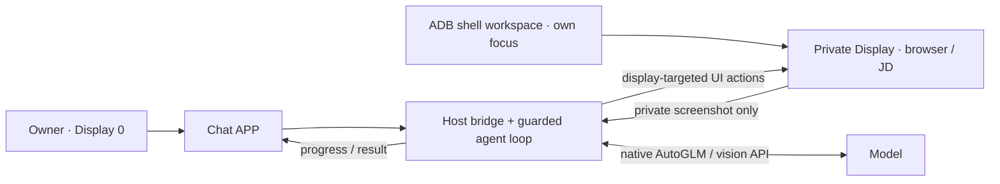

# OpenPhone Agent

GPT-style Android chat + a UI agent working on a separate display while the owner keeps using Display 0. Uses an already-authorized ADB computer connection; no root or system-file modifications.



## Deploy

Verified on the Android 15/API 35 ARM64 emulator. Requires Android SDK platform 35, build-tools 35.0.0, a JDK and authorized ADB. The ROM must allow shell-owned trusted displays with independent focus; unsupported devices fail closed.

```bash
export ANDROID_HOME="$HOME/Library/Android/sdk"
export JAVA_HOME="/Applications/Android Studio.app/Contents/jbr/Contents/Home"
./gradlew assembleDebug
adb install -r app/build/outputs/apk/debug/app-debug.apk
python3 scripts/workspace_runtime.py start
python3 scripts/chat_bridge.py --provider mock
# In another terminal (Pillow + Tk required):
python3 scripts/display_viewer.py --both
```

Open **OpenPhone Agent** and send a task. No main-screen recording prompt is needed. Normal tasks start the isolated workspace automatically; read-only runs never create or navigate it. To use the deployed real model instead of mock, stop the manual mock bridge and run `python3 scripts/autoglm_runtime.py start`; see [model deployment](docs/autoglm-n30285.md). Manual diagnostics: `./scripts/agentctl.sh open-browser https://example.com`, `tap X Y`, `text 5090`, `capture`.

## Configuration

`ADB`: optional ADB path; `ANDROID_HOME` / `JAVA_HOME`: build tools; `AGENT_PROVIDER`: mock/openai/autoglm; `AGENT_BASE_URL`: OpenAI-compatible endpoint; `AGENT_MODEL`: vision model name; `AGENT_API_KEY`: optional bearer token; `CAPTURE_DIR`: local captures. Never commit credentials.

## Safety and boundaries

Actions verify live isolation flags and owner focus before/after execution; display 0 is never an agent target. Explicit “open JD” tasks launch JD before model observation. Screenshots/results are audited in `runs/`; the owner preview stays local and is never sent to the model. Passwords, CAPTCHA, agreements, orders and payment require human action. Private typing currently supports ASCII only; Chinese Gboard input remains on the owner screen.

This is an ADB-assisted prototype, **not** a universal APK-only solution. A third-party app may reuse/migrate its task when opened on both displays; don't promise arbitrary-app duplication. The old MediaProjection workspace is read-only and cannot execute agent actions. See [isolation design and regression evidence](docs/workspace-isolation.md). Run tests with `python3 -m unittest discover -s tests`.
