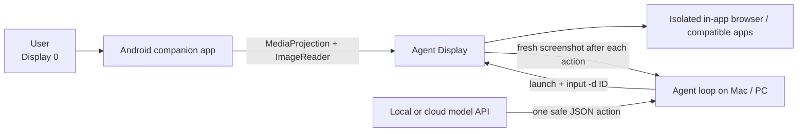

# OpenPhone Agent

Android prototype for running an agent on a second display while the owner keeps using the primary screen. No root or system-file modifications are required; a host-side controller uses ADB, which the challenge explicitly permits.



## What works

- Provides a GPT-style chat screen where the owner can submit a natural-language task.
- Bridges chat tasks to the host-side agent and returns live progress/results to the conversation.
- Creates a `720×1280` touch-capable virtual display in a foreground service.
- Keeps the main display available to the user.
- Runs an app-owned browser task on the agent display, isolated from the owner's Chrome task.
- Routes taps/swipes/text to the agent display ID only.
- Captures the agent display to `files/display/latest.png` for visual reasoning.
- Runs an AndyClaw-style observe/act loop against any OpenAI-compatible model API.
- Validates every model action, stops repeated/no-change loops, and writes an audit trail.
- Pauses for the owner before payment, passwords, sending, deletion, or other sensitive actions.

## Run

Requirements: Android 9+, Android SDK/ADB, Java 17, and USB debugging.

```bash
export ANDROID_HOME="$HOME/Library/Android/sdk"
export JAVA_HOME="/path/to/jdk-17/Contents/Home"
./gradlew assembleDebug
adb install -r app/build/outputs/apk/debug/app-debug.apk
```

Open **OpenPhone Agent**, tap **Start agent display**, choose **Entire screen**, then approve **Start**. The permission is one-session only.

```bash
./scripts/agentctl.sh state
./scripts/agentctl.sh open-browser https://www.wikipedia.org/
./scripts/agentctl.sh tap 670 55
./scripts/agentctl.sh capture
```

Open the private display in a separate, read-only Mac window without affecting
the phone owner's screen or input:

```bash
python3 scripts/display_viewer.py --always-on-top
```

Run the chat-to-agent bridge (mock mode needs no API key):

```bash
python3 scripts/chat_bridge.py --provider mock
```

Then type a task in the Android app. For a real vision model, set the API
environment variables below and start the bridge with `--provider openai`.

Verify the complete loop without an API:

```bash
python3 scripts/agent_loop.py \
  --provider mock \
  --goal "Open a harmless test page on the private display"
```

Connect Ollama, LM Studio, llama.cpp, or another OpenAI-compatible service:

```bash
export AGENT_PROVIDER=openai
export AGENT_BASE_URL=http://192.168.1.35:11434/v1
export AGENT_MODEL=your-vision-model
# export AGENT_API_KEY=...  # only when the endpoint requires one

python3 scripts/agent_loop.py \
  --goal "Find a product, compare the visible prices, add the cheapest to the cart, and stop before checkout"
```

Each run is saved under `runs/<timestamp>/` with `run.json`, `events.jsonl`, and
the screenshot used for every decision. The API key is never written to the run log.

## Environment variables

- `ADB`: optional path to `adb`; otherwise the script checks `PATH`, `ANDROID_HOME`, and the standard macOS SDK location.
- `CAPTURE_DIR`: local screenshot directory (defaults to `captures`).
- `AGENT_PROVIDER`: `mock` or `openai`.
- `AGENT_BASE_URL`: OpenAI-compatible base URL, commonly `http://host:11434/v1` for Ollama.
- `AGENT_MODEL`: model name exposed by the API. A vision-capable model is required for screenshot-only operation.
- `AGENT_API_KEY`: optional bearer token; keep it local and never commit it.

## Current boundary

Android does not let an ordinary app reliably keep an arbitrary third-party app on a chosen display. Some apps, including Chrome, reuse one task and can migrate it back to display 0 when the owner opens the same app. The demo therefore uses an app-owned WebView activity with a separate task affinity; the host controller places that task through an already-authorized ADB connection. A text-only model will need a future Accessibility-tree adapter; the current model loop uses screenshots and therefore expects vision input. Sensitive steps such as passwords and payments always remain user-confirmed.
