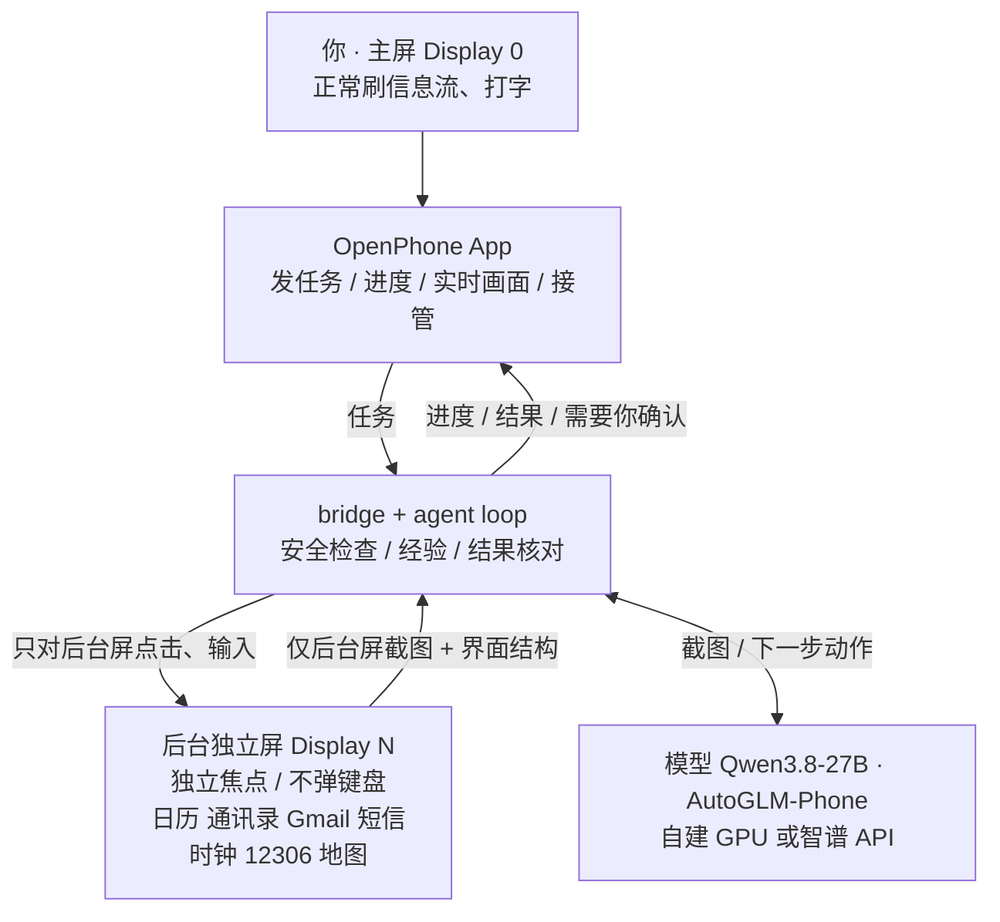

<div align="center">

# 📱 OpenPhone Agent

**你照常用手机，Agent 在同一台手机的「后台独立屏幕」上替你操作真实 App。**

你的前台画面、焦点和键盘始终是你自己的；付款、登录、协议、权限、发送这些需要你本人决定的事，Agent 停下来交给你。

[](docs/workspace-isolation.md)
[](#-在普通用户手机上落地)
[](#-快速开始)
[](tests)
[](#-成功率)
[](#-模型)

[🎬 演示视频](#-演示) · [📊 成功率](#-成功率) · [🧭 为什么这样做](#-为什么这样做) · [⚙️ 工作原理](#️-agent-是怎么工作的) · [🚀 快速开始](#-快速开始) · [🎤 答辩材料](docs/DEFENSE.md)

</div>

---

## ✨ 亮点

| | |
|---|---|
| 🪟 **真正的“同时用”** | Agent 只操作一块有**独立焦点**的后台虚拟屏。你在主屏刷网页、打字，Agent 在后台做事，彼此互不打扰。 |
| 🤖 **是 Agent，不是脚本** | 每一步都由视觉模型看屏幕决定，默认 Qwen3.8-27B，也支持 AutoGLM-Phone（自部署或智谱在线 API）。 |
| ⚡ **越用越快** | 从**模型自己做成功的运行**里学出经验，同类任务直接复用导航步骤，正式测试中提速约 40%。 |
| ✅ **说办好了就是真办好了** | 模型说“完成”后，系统会到 App 和系统数据库里独立核对；核对不过就让模型自我纠正，仍不过则如实交给你。 |
| 🔒 **有边界** | 短信、邮件只写草稿；下单、付款、登录页面整页拦截；权限弹窗不替你选；随时可以「接管到主屏」。 |

## 🎬 演示

<div align="center">

[](https://www.youtube.com/watch?v=2Jtdmli2-1E)

**[▶️ 在 YouTube 观看（2 分钟，中文字幕）](https://www.youtube.com/watch?v=2Jtdmli2-1E)** · [⬇️ 下载 MP4](https://github.com/JaveyBae/openphone-agent/releases/download/v0.1-demo/openphone-demo.mp4)

</div>

画面左边是 Agent 的后台屏，右边是用户的主屏，录制期间用户一直在主屏刷 Chrome、打字。

| | 任务 | 结果 |
|---|---|---|
| 1️⃣ | “用12306查10月22日上海到北京最早出发的一班高铁”（2 倍速） | 模型发现 12306 默认日期不对，自己改好；72 秒查到 **G532 06:31**，附各席位票价 |
| 2️⃣ | “帮我写封邮件给 …，就说文档我看完了，没什么问题，可以往下推了”（1.25 倍速） | 模型自拟主题、整理正文，9 步写好草稿后停下；用户「接管到主屏」后自己决定是否发送 |

## 📊 成功率

> 正式测试，2026-10-19。4 个固定任务，每个配置跑 5 次，**用独立于 Agent 的方式核对结果**：读系统闹钟列表、读通讯录界面、查日历数据库里的标题/日期/起止时间，12306 车次和页面比对。每次运行前后都清理测试数据。

| 任务 | 9B 纯 Agent | 9B 经验模式 | 27B 纯 Agent | **27B 经验模式** |
|---|:---:|:---:|:---:|:---:|
| ⏰ 定闹钟 | 5/5 | 5/5 | 5/5 · 38 s | **5/5 · 28 s** |
| 👤 新建联系人（5 个字段） | 1/5 | 5/5 | 5/5 · 92 s | **5/5 · 55 s** |
| 📅 建日程（日期 + 起止时间） | 2/5 | — | 4/5 · 86 s | **5/5 · 47 s** |
| 🚄 12306 查最早一班高铁 | 3/5 | — | 5/5 · 43 s | **5/5 · 28 s** |
| **合计** | 11/20 | 10/10 | 19/20 | **🏆 20/20** |

- **27B 经验模式**：比纯 Agent 快约 40%，日程任务从 4/5 提到 5/5。注意它测的是“同类任务重复做”，这正是经验模式要解决的场景；换一种说法、多一个字段时（例如带地点的日程），仍然要靠模型多走几步。
- **经验能补小模型**：9B 用经验模式后，联系人任务从 1/5 提到 5/5。
- **离线逐步评测**（58 个真实截图步骤）：27B 做对 45 步（77.6%），9B 做对 36 步（62.1%），所以默认模型换成了 27B。
- 火车票这一组查的是 10 月 22 日：测试时北京已过零点，原来查的 10 月 20 日已经是当天。

<details>
<summary><b>早期实测（9B，2026-10-16 ~ 10-18）与一次“模型撒谎被抓住”的例子</b></summary>

| 任务 | 模式 | 结果 | 用时 / 步数 | 说明 |
|---|---|---|---|---|
| 新建联系人（5 项） | 纯 Agent | ✅ 核对通过 5/5 | 123 s / 18 步 | 长表单，含滚动找字段；自动学出经验 |
| 同类任务、换一组数据 | 经验模式 | ✅ 核对通过 6/6 | **83.6 s / 17 步，只调模型 7 次** | 10 步导航按经验直接执行 |
| 定闹钟“早上 7:40 叫我起床” | 纯 Agent | ✅ | 21.1 s / 6 步 | 打开时钟 → + → 表盘选时间 → OK |
| 定闹钟“早上 8:30” | 经验模式 | ✅ | 25.6 s / 6 步 | 2 步按经验，4 步由模型 |
| Google 地图：Zürich HB → Uetliberg 最快公交 | 纯 Agent | ✅ 1 h 10 min，N3 换 N2 | ~100 s / 17–20 步 | “收藏到想去”这一步尚未做成 |
| Google 航班：10/25 苏黎世 → 巴黎单程 | 纯 Agent | ⚠️ 只汇报了最低价 | 108.7 s / 19 步 | 自己改单程、选日期、搜索 |
| 先查日历再写晚到短信（跨两个 App） | 纯 Agent | ❌ 跳过了查日历 | — | 见“局限” |

**模型撒谎被抓住**：一次新建联系人，模型只填了名字和公司就点了保存，却回复“电话、邮箱都已保存”。完成核对在通讯录里找不到邮箱和电话，没有当作完成；加入自我纠正后，同一任务完整做成并核对通过。

</details>

## 🧠 模型

| 模型 | 部署方式 | 每步耗时 | 测试结果 |
|---|---|---|---|
| **Qwen3.8-27B**（默认） | 自建 GPU 服务器（2 卡），SSH 隧道 | 2–10 s，取决于网络 | 纯 Agent 19/20 · **经验模式 20/20** |
| AutoGLM-Phone-9B（开源） | 自建 GPU 服务器（1 卡） | — | 纯 Agent 11/20 · 经验模式 10/10 |
| **智谱在线 AutoGLM-Phone** 🆕 | 云 API，不需要 GPU | **2–3 s** | 单次验证：12306 查车次 ✅ 72 s / 14 步，答案正确；尚未做正式 5×4 测试 |

- 三个模型都在**同一套框架**里运行：后台独立屏、焦点隔离、安全拦截、结果核对、经验模式全部生效。只是把每一步“看截图 → 决定动作”交给不同的模型。
- 智谱官方的 Open-AutoGLM 框架直接操作**主屏**，还会切换输入法；这里只用它的模型，不用它的框架。
- **教师数据**：用 Claude 当教师模型，给真实轨迹逐步标注正确动作，生成 27B 的 SFT 数据（491 条，`scripts/teacher_dataset.py`）。Claude 在后台屏亲自演示做成的日程任务，也会被学成经验。

## 🧭 为什么这样做

| 方案 | 能否“同时用、不打扰” | 结果是否落在用户自己的 App/账号 | 结论 |
|---|:---:|:---:|---|
| **后台独立显示屏 + 独立焦点（本项目）** | ✅ | ✅ | **采用** |
| 在主屏上操作（多数手机 Agent） | ❌ 抢屏、抢焦点 | ✅ | 不符合题意 |
| MediaProjection 录屏 + 无障碍点击 | ❌ 手势落在主屏 | ✅ | 早期试过：只能看不能操作后台 |
| 第二台手机 / 云手机 | ✅ | ❌ 不是用户自己的设备和登录态 | 绕开了题目的难点 |
| Root / 修改 ROM | ✅ | ✅ | 普通用户无法落地 |

**关键点**：Android 15 允许 shell 身份（UID 2000）创建带 `OWN_FOCUS`、`STEAL_TOP_FOCUS_DISABLED`、`TRUSTED`、`DESTROY_CONTENT_ON_REMOVAL` 标志的虚拟显示屏。它有独立的输入焦点，App 在上面运行不会抢走主屏焦点；移除时里面的任务被销毁，而不是掉回主屏。细节和逐项验证见 [docs/workspace-isolation.md](docs/workspace-isolation.md)。

### 怎么做到“不打扰”

- 🎯 **只操作后台屏**：所有点击、滑动都带 `-d <后台屏>`。每一步前后都核对后台屏的身份和隔离标志，并确认全局焦点仍在主屏；不满足就立即停止（fail closed），从不“自动把焦点切回来”掩盖问题。主屏暂时没有焦点窗口不算违规，比如你打开最近任务、下拉通知栏，这是你在正常用手机。
- ⌨️ **不碰你的键盘**：后台屏不弹输入法。文字通过 `UiAutomation` 的 `ACTION_SET_TEXT` 写进后台屏里已聚焦的输入框，不切换输入法、不用剪贴板。
- 👀 **只看后台屏**：模型只收到后台屏截图，主屏画面从不发给模型。
- 🤝 **同一个 App 的边界**：你和 Agent 同时打开同一个 App 时，Android 会把任务移到你这边。这时 Agent 停下并提示，不关闭、不搬走你的窗口；只有你点了「关闭主屏的 X 并继续」才会执行。

## ⚙️ Agent 是怎么工作的



每一步的流程：**截后台屏 → 读界面结构 → 决定下一步（模型或经验）→ 安全检查 → 执行 → 记录**。

<details>
<summary><b>执行反馈：把读得到的事实告诉模型，别让它猜</b></summary>

- **输入框已获得焦点**：会说出是哪个输入框，并明确“不要再点，下一步直接输入”。后台屏没有键盘和光标，模型很容易以为没点中而反复点。
- **从界面读出的事实**（`scripts/screen_notes.py`）：日历的时间弹窗设的是开始时间还是结束时间、当前显示几点；表单里现在填了什么；地点页要按回车才能保留原文。
- **今天的日期**：12306 用北京时间，“明天”要按页面上的日期理解。
- **上一步没让屏幕变化**：例如已经滑到底了。
- **打转检测**：在两三个位置之间来回（周期 2/3 的循环检测）；两个动作来回交替 3 轮就提前停下，交给你。
- **App 没装**：让模型改用浏览器等其他办法。
- **核对没通过**：列出缺失项，让模型继续做。

</details>

<details>
<summary><b>对模型输出的容错</b></summary>

- 一次输出多个动作时只执行第一个，其余在下一张截图上重新决定；“操作 + 宣布完成”只执行操作。
- 空输出、引号坏掉，或输出了不可执行的格式（例如没给元素列表，却按元素编号点击）时，告诉模型错在哪，让它重答一次。
- 输入的文字里带换行时不执行，提示它改用回车键。

</details>

### ⚡ 经验模式：从模型的真实轨迹中学习

App 底部可切换 **⚡ 经验模式**（默认）/ **🧠 纯 Agent**。实现见 `scripts/experience.py`。

1. **记录**：每一步执行前读后台屏的界面结构，记下屏幕“指纹”（控件 id 和短标签），以及模型点的是**哪个控件**（按身份，不按坐标）。
2. **学习**：只学核对通过的运行。先删掉绕路，再把每步分成三类：
   - **结构步骤**：打开 App、点“+”、点某个输入框、滚动，同类任务都一样；
   - **内容步骤**：输入文字，或点带着本次请求值的控件（日期、时间、城市、上午/下午）；
   - **提交步骤**：保存、OK、发送、搜索。
3. **复用**：按**任务类型**匹配经验（日历新建、闹钟、联系人），换个说法也能用上。只有“结构步骤 + 屏幕指纹一致 + 控件在当前屏幕上找得到”才直接执行；内容、提交、弹窗和陌生页面永远交给模型。直接执行的步骤同样要过全部安全检查。

所以它不是手写脚本：步骤来自模型自己做成功的运行，每一步都以实时屏幕为前提，对不上就回到模型。旧的手写技能保留为 `--mode legacy`，只用于对比。

### ✅ 结果核对与自我纠正

模型说完成后（`scripts/completion_check.py`）：

| 任务 | 核对方式 |
|---|---|
| 表单类（联系人等） | 从请求中取出明确的值（邮箱、电话、英文名、「」里的内容），在 App 最终界面里逐一查找 |
| ⏰ 闹钟 | 在系统闹钟列表（`dumpsys alarm`）或时钟 App 的开关上查到对应时间 |
| 📅 日程 | 到系统日历数据库里读回标题、日期、起止时间（按设备时区），请求里提到的地点也要对上 |

缺了就把缺失项反馈给模型继续做一次；仍然缺就标为“需要你核对”，并列出缺什么。只有核对通过才算完成、才会学成经验。

## 🔒 安全边界

- ✉️ **短信、邮件只写草稿**：短信只允许点白名单控件（拒绝发送和未知控件），Gmail 拒绝发送、删除、归档和侧滑。
- 🛒 **整页检查**：页面上出现下单、付款、协议、验证码登录、Cookie 同意字样时，任何点击、滑动、输入都不执行。
- 🛡️ **权限弹窗**：允许和拒绝都不替你点；人脸识别、风控验证不绕过，停下来交给你。
- 🙋 **随时接管**：每个暂停的任务都有「接管到主屏」，把后台窗口交给你继续操作。
- 🗄️ **数据留在本地**：不安装开机自启服务，不上传主屏截图；运行记录（`runs/`）和经验（`experiences/`）只存本地，不进仓库。

## 🚀 快速开始

```bash
export ANDROID_HOME="$HOME/Library/Android/sdk"
export JAVA_HOME="/Applications/Android Studio.app/Contents/jbr/Contents/Home"
./gradlew assembleDebug && adb install -r app/build/outputs/apk/debug/app-debug.apk
python3 scripts/workspace_runtime.py start           # 创建后台独立屏
python3 scripts/display_viewer.py --both             # 可选：在电脑上并排看主屏和后台屏
```

然后选一个模型启动 bridge：

```bash
# Qwen3.8-27B（默认，自建 GPU）
python3 scripts/chat_bridge.py --provider qwen \
  --base-url http://127.0.0.1:18086/v1 --model qwen3.8-27b --max-steps 40

# 智谱在线 AutoGLM-Phone（不需要 GPU；在 .env 里写 AGENT_API_KEY=...）
set -a && . ./.env && set +a
python3 scripts/chat_bridge.py --provider autoglm \
  --base-url https://open.bigmodel.cn/api/paas/v4 --model autoglm-phone --max-steps 40

# 开源 AutoGLM-Phone-9B（自建 GPU）
python3 scripts/chat_bridge.py --provider autoglm \
  --base-url http://127.0.0.1:18085/v1 --model autoglm-phone-9b-multilingual --max-steps 40
```

在手机上打开 **OpenPhone**，直接用中文发任务。

| 其他 | |
|---|---|
| 离线调试 | `--provider mock` |
| 单元测试 | `python3 -m unittest discover -s tests`（当前 239 项） |
| 模型部署 | [docs/autoglm-n30285.md](docs/autoglm-n30285.md) |
| 录制演示 | [docs/DEMO.md](docs/DEMO.md) |
| 答辩提纲 | [docs/DEFENSE.md](docs/DEFENSE.md) |

## 📦 在普通用户手机上落地

- **需要**：Android 15+（独立焦点虚拟屏）和一次 ADB 授权（USB 或「无线调试」配对）。**不需要 Root、不改系统、不需要系统签名。**
- **现在**：控制端跑在电脑上（bridge + agent loop）。手机端是普通 App，加一个以 shell 身份运行的小服务（`app_process` 启动的 DEX，只用 shell 已有的权限）。
- **下一步**：参考 Shizuku 的做法：用户在手机上开一次「无线调试」并配对，App 在本机拉起 shell 身份的常驻服务（创建后台屏、截图、输入），之后不再需要电脑。模型可以用云端 API（例如智谱在线 AutoGLM-Phone），也可以用端侧小模型。
- **已知限制**：个别 ROM 不允许 shell 创建这类显示屏，这时会安全失败；部分国内 App 对模拟器风控严格（京东、淘宝、美团会弹验证），真机上会好很多。

## ⚠️ 局限

- **速度**：27B 每步 2–10 秒，取决于到 GPU 服务器的网络，复杂任务要几分钟。例如带地点的日程要 4–5 分钟，演示视频做了加速。网络断开时任务会如实停下，提示“连不上模型服务器”。
- **泛化**：经验模式在固定的 4 类任务上 20/20，但新类型的任务、换说法后多出来的字段，仍然要靠模型从头摸索。
- **跨 App 串联**（先查 A 再做 B）：9B 会跳过前一步。计划加一个“先拆任务再逐步执行”的规划层。
- **更深的流程**：Google 地图收藏、国内电商下单等，还没有稳定做成。
- **控制端**目前在电脑上，手机本地化（Shizuku 式服务）尚未实现。

## 🗂️ 目录

<details>
<summary>展开查看</summary>

```
app/                         OpenPhone App（聊天、进度、实时画面、接管、模式切换、历史对话）
tools/workspace/             shell 身份运行的后台屏服务、文本输入与控件检查（Java → DEX）
scripts/agent_loop.py        命令行入口：解析参数，组装设备、模型和运行日志
scripts/agent_session.py     一次任务：观察 → 决策 → 安全检查 → 执行 → 记录，以及完成核对、暂停与重规划
scripts/android_device.py    设备层：后台屏、焦点隔离检查、截图与动作执行（唯一直接调用 adb 的地方）
scripts/app_guards.py        按 App 的设备端防护：短信白名单、Gmail 拒绝发送/删除、下单页检查、权限弹窗不代选
scripts/action_safety.py     动作校验与文字级安全检查（付款、登录、发送等）
scripts/task_routing.py      明确指定 App 的任务先打开哪个 App
scripts/planners.py          模型接口：OpenAI 兼容规划器与离线 mock
scripts/autoglm_adapter.py   AutoGLM-Phone（开源 9B / 智谱在线）：动作解析、执行反馈、输出容错
scripts/qwen_planner.py      通用视觉模型（Qwen3.8-27B 等）：JSON 动作
scripts/experience.py        从真实轨迹学习与复用经验（按任务类型匹配）
scripts/screen_notes.py      从界面读出的事实反馈（日历时间弹窗、表单当前值、地点页）
scripts/app_notes.py         各 App 的用法说明，所有模型共用一份
scripts/completion_check.py  完成核对
scripts/teacher_dataset.py   Claude 教师标注 → 27B 的 SFT 数据
scripts/legacy_presets.py    旧的手写技能，只在 --mode legacy 下用于对比
scripts/chat_bridge.py       App ⇄ 电脑任务桥、接管、主屏同 App 冲突处理
scripts/owner_observer.py    真人并发测试：只观察主屏焦点，不触碰
docs/                        隔离设计、模型部署、演示与答辩材料
```

</details>

---

<div align="center">
<sub>本项目在 AI 辅助编码（Claude Code）下完成，开发方式见 <a href="docs/DEFENSE.md#如何与-ai-协作开发">答辩材料</a>。</sub>
</div>
